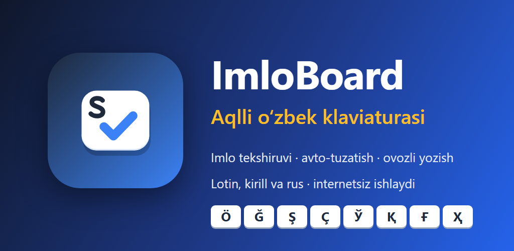
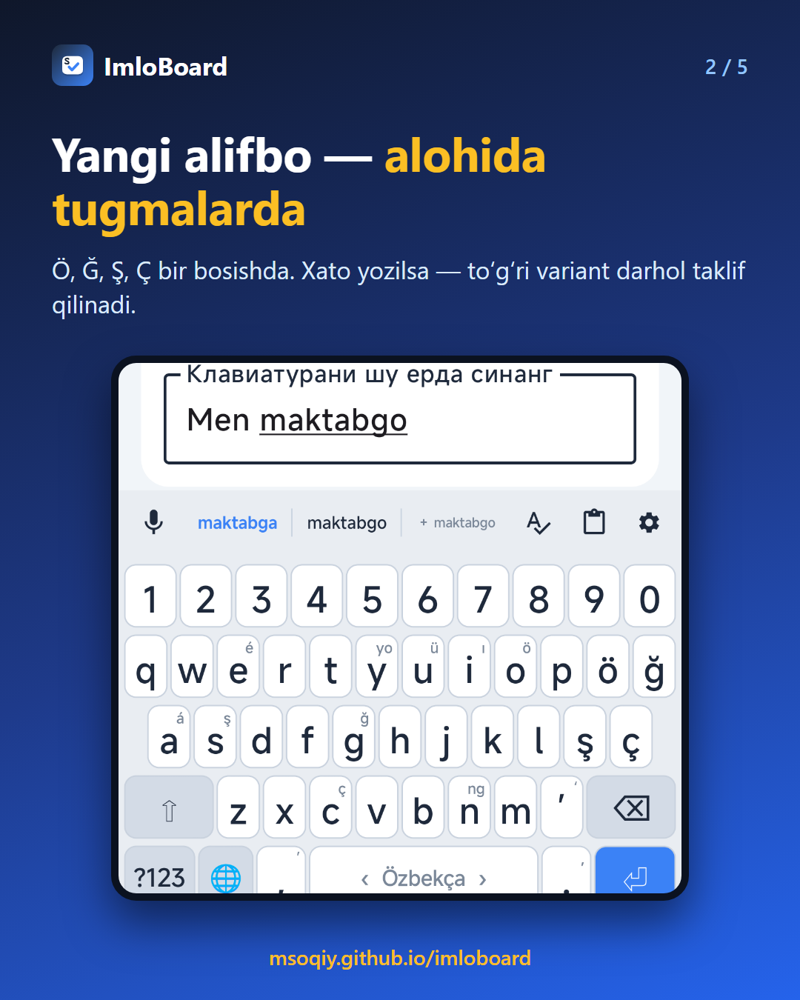
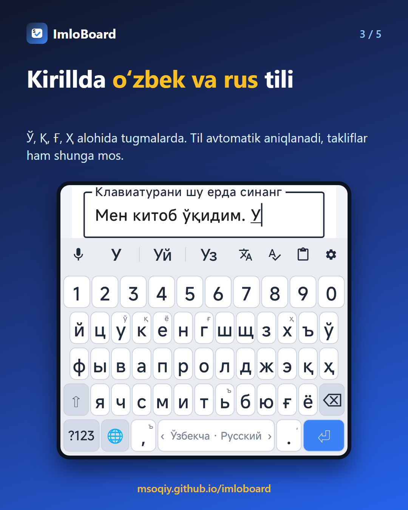
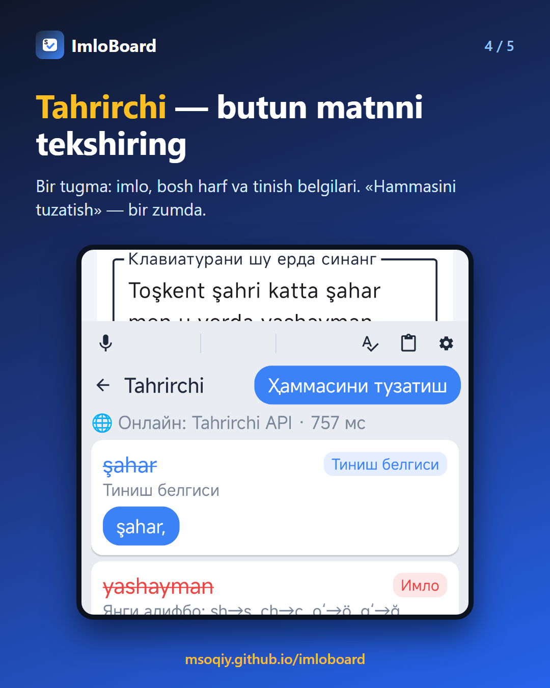
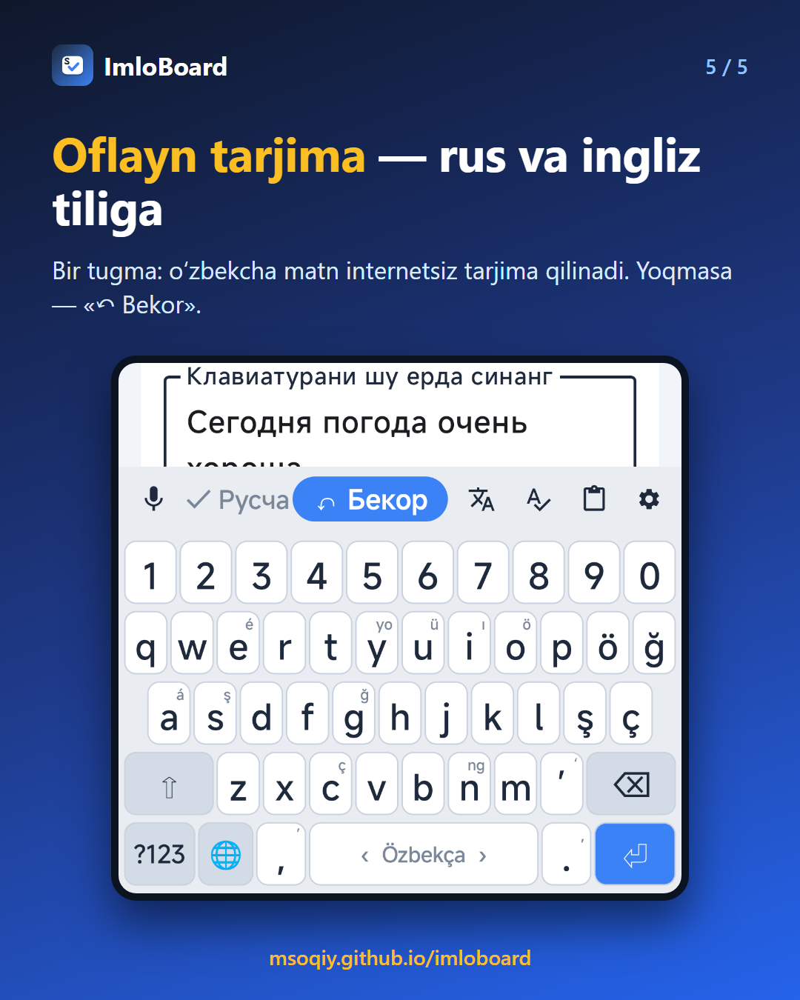
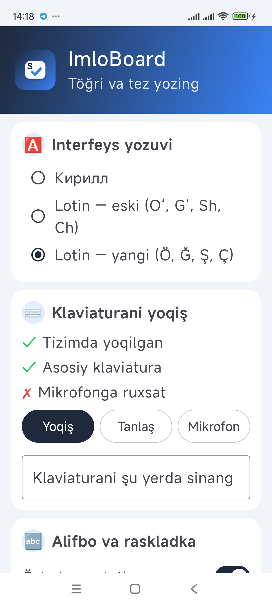

# ⌨️ ImloBoard

**Aqlli o‘zbek klaviaturasi · Imlo tekshiruvi · Yangi alifbo (Ö, Ğ, Ş, Ç) · Android · o‘zbek tilida**

Yozing — ImloBoard xatoni ko‘rsatadi, to‘g‘ri variantni taklif qiladi va keyingi so‘zni oldindan aytadi. Lotin, kirill va rus tilida, internetsiz ham.

## Ilova haqida

«ImloBoard» — o‘zbek tilida savodli yozishga yordam beradigan Android klaviaturasi. U har qanday ilovada — messenjer, pochta, hujjat va ijtimoiy tarmoqlarda ishlaydi: so‘zni yozayotganingizda xatoni aniqlaydi, to‘g‘ri variantlarni taklif qiladi, kerak bo‘lsa avtomatik tuzatadi va keyingi so‘zni oldindan aytadi. 2026-yilda qabul qilingan qonun bo‘yicha yangi lotin harflari (Ö, Ğ, Ş, Ç) va amaldagi alifbo, o‘zbek kirill yozuvi hamda rus tili qo‘llab-quvvatlanadi. Asosiy imkoniyatlar internetsiz ishlaydi. Reklama yo‘q, ro‘yxatdan o‘tish shart emas.

## Imkoniyatlar

- **Internetsiz imlo tekshiruvi:** Hunspell lug‘atlari (lotin va kirill — 93 mingdan ortiq o‘zak, 200 mingdan ortiq so‘z shakli) va qo‘shimchalar tahlili
- **Avto-tuzatish va takliflar:** Levenshteyn masofasi, klaviaturadagi qo‘shni tugmalar va 663 ming gaplik korpusdagi so‘z chastotalari asosida
- **Keyingi so‘zni bashorat qilish:** korpus bigramlari va sizning yozish odatlaringiz bo‘yicha o‘rganadi
- **Yangi alifbo:** Ö, Ğ, Ş, Ç alohida tugmalarda; eski shakl (oʻ, gʻ, sh, ch) yozilsa yangisiga o‘giriladi
- **Kirillda o‘zbek va rus tili** bitta raskladkada — til avtomatik aniqlanadi (Ў, Қ, Ғ, Ҳ alohida tugmalarda)
- **Tahrirchi — chuqur tahrir:** bir tugma bilan butun matn imlo, bosh harf va tinish belgilari bo‘yicha tekshiriladi
- **Oflayn tarjima (yangi):** o‘zbekcha matnni bir tugma bilan rus yoki ingliz tiliga tarjima qiling — internetsiz, telefonning o‘zida (NLLB modeli sozlamada yoqilganda bir marta yuklanadi, ~440 MB); «↶ Bekor» — asl matn qaytadi
- **Ovozli yozish:** o‘zbek nutqini taniydi (internetsiz ham); kirill rejimida matn kirillda yoziladi
- **Shaxsiy lug‘at:** tizim xato deb belgilagan, lekin siz to‘g‘ri deb bilgan so‘zlarni (ism, atama) qo‘shing
- **Raqamlar qatori, buferlar tarixi,** tugmani bosib turish bilan qo‘shimcha harflar, kunduzgi va tungi mavzu
- **Interfeys uch yozuvda:** kirill, lotin (eski) va lotin (yangi alifbo)
- **Maxfiylik:** parol maydonlarida tekshiruv o‘chadi, telefon raqamlari va kartalar serverga yuborilmaydi

## Yangiliklar — v1.1 (27.10.2026)

- 🌐 **Oflayn tarjima** — rus va ingliz tiliga, internetsiz; tarjimadan keyin «↶ Bekor» tugmasi yoki ⌫ bilan asl matn qaytadi
- 🔤 **Harflar bir xil o‘lchamda** — ayniqsa kirill raskladkasida (щ, ж, ю va boshqalar endi kichraymaydi)
- 🔠 **«Shrift o‘lchami» sozlamasi ishlaydi** — 80% dan 140% gacha, har qanday telefonda sezilarli
- ✍️ **Gap boshida bosh harf** endi bunday so‘ramaydigan ilovalarda ham ishlaydi (pochta, URL va parol maydonlaridan tashqari)
- ✅ Barcha sozlamalar telefonda birma-bir sinovdan o‘tkazildi
- 🍏 **iOS versiyasi tayyorlanmoqda** — umumiy yadro (lug‘at, imlo, takliflar, Tahrirchi) Android va iOS uchun bitta kod (Kotlin Multiplatform)

## Qanday ishlaydi

1. Ilovani o‘rnating va «Yoqish» tugmasini bosib, ImloBoard’ni klaviaturalar ro‘yxatida yoqing
2. «Tanlash» tugmasi orqali uni asosiy klaviatura qiling
3. Istalgan ilovada yozing — takliflar qatori xatoni ko‘rsatadi, probel bosilganda aniq xato avtomatik tuzatiladi
4. Matnni chuqur tekshirish uchun **A✓** tugmasini bosing — topilgan xatolar ro‘yxati chiqadi, «Hammasini tuzatish» bilan bir zumda to‘g‘rilanadi
5. Tarjima uchun sozlamalarda «Oflayn tarjima»ni yoqing va tilni tanlang — paneldagi tarjima tugmasi matnni o‘giradi

## O‘rnatish

1. **[imloboard.apk](https://github.com/MSoqiy/imloboard/raw/main/apk/imloboard.apk)** faylini yuklab oling (20 MB; APK papkasi — [apk/](https://github.com/MSoqiy/imloboard/tree/main/apk)).
2. Faylni oching; telefon so‘rasa, «Noma'lum manbalardan o‘rnatish»ga ruxsat bering.
3. «O‘rnatish»ni bosing, so‘ng ilovada klaviaturani yoqing. Android 7.0 va undan yuqori.

## Ekranlar

## English

**ImloBoard** — a smart Android keyboard for the Uzbek language: offline spell checking and autocorrection (Hunspell + corpus statistics), next-word prediction, the new Uzbek Latin letters Ö, Ğ, Ş, Ç, Uzbek Cyrillic and Russian in one layout, online grammar check via Tahrirchi, offline translation into Russian and English (new in v1.1), and Uzbek voice typing. An iOS version is in development. Free, ad-free. Part of the «Foydali ilovalar» collection by Mamasaidov M.A.

---

**Muallif:** Mamasaidov M.A. — Toshkent shahar Mirzo Ulug‘bek markazi o‘qituvchisi · Tetrasoft · ✉ soqiy65@gmail.com · 🌐 https://msoqiy.github.io · «[Foydali ilovalar](https://msoqiy.github.io/ilovalar/)»

**Boshqa ilovalar:** [So‘zla](https://github.com/MSoqiy/sozla) · [Otin buvi](https://github.com/MSoqiy/otin-buvi) · [Donish bobo](https://github.com/MSoqiy/donish-bobo) · [Bayon AI](https://github.com/MSoqiy/bayon-ai) · [Tilbilgich En AI](https://github.com/MSoqiy/tilbilgich-en) · [Tilbilgich Fr AI](https://github.com/MSoqiy/tilbilgich-fr) · [Tilbilgich De AI](https://github.com/MSoqiy/tilbilgich-de) · [Tilbilgich Ar AI](https://github.com/MSoqiy/tilbilgich-ar) · [Aljabr](https://github.com/MSoqiy/aljabr) · [GeoSayyoh](https://github.com/MSoqiy/geosayyoh)

Kalit so‘zlar: o‘zbek klaviaturasi, o‘zbekcha klaviatura, imlo tekshirish, imlo xatolarini tuzatish, yangi o‘zbek alifbosi, Ö Ğ Ş Ç harflari, kirill klaviatura, avto-tuzatish, ovozli yozish, Tahrirchi, oflayn tarjima, o‘zbekcha rus tarjima, uzbek keyboard, uzbek spell checker, узбекская клавиатура, проверка орфографии узбекский, android apk
